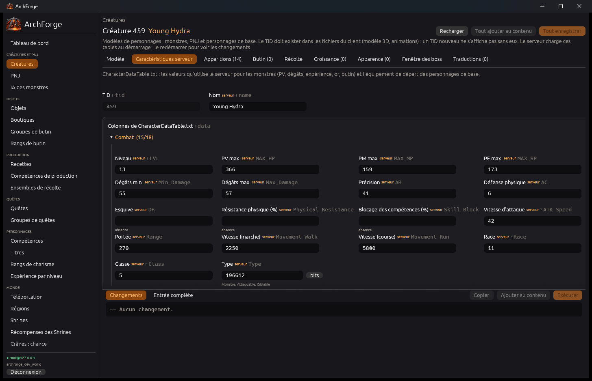
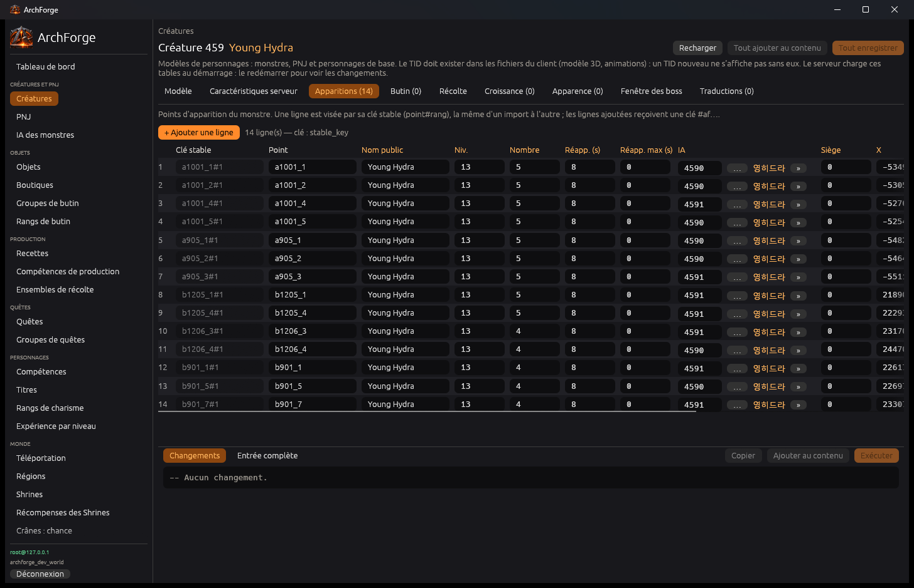

<p align="center">
  
</p>

<h1 align="center">ArchForge</h1>

<p align="center">
  <b>Éditeur de la base de données d'<a href="https://github.com/BlaMacfly/ArchCore">ArchCore</a>, l'émulateur de serveur ArchLord</b><br>
  Application de bureau 100 % Rust (egui) · MariaDB · Windows, Linux, macOS
</p>

ArchForge crée et modifie le contenu du monde d'ArchCore sans écrire de SQL : créatures, apparitions, butin
et récolte, PNJ et leurs fonctions, IA des monstres, objets, boutiques, recettes, quêtes, compétences et
maîtrises, titres, téléportation, régions, Shrines, sièges, guildes, traductions, comptes. Chaque champ est
expliqué, des sélecteurs aident à choisir les valeurs et les bits, et la requête SQL produite est affichée —
les seuls changements, ou l'entrée complète pour une sauvegarde — à copier, à exécuter sur la base ou à
**ajouter à la couche de contenu** d'ArchCore.

C'est l'« Éditeur de la base de données » de la [feuille de route d'ArchCore](https://github.com/BlaMacfly/ArchCore/wiki/FR-Feuille-de-route),
sur le modèle de [Keira3](https://github.com/azerothcore/Keira3) (AzerothCore).



## 1. Ce que fait Keira3 (analyse)

Keira3 est l'éditeur de base de données d'AzerothCore (WoW 3.3.5) : Angular 22, Electron 41, Bootstrap,
monorepo Nx, `mysql2` (avec tunnel SSH), `squel` pour construire le SQL, SQLite pour les données du client
(sorts…). Son fonctionnement tient en quelques mécanismes :

| Mécanisme | Dans Keira3 |
|---|---|
| **Éditeur générique** | des classes de base (`SingleRowEditorService`, `MultiRowEditorService`, `…ComplexKey…`) : un éditeur concret ne déclare que sa table, sa clé et sa classe de ligne ; le formulaire, le rechargement et le SQL sont hérités |
| **SQL produit** | `MysqlQueryService` : `getUpdateQuery` (seulement les colonnes changées), `getDiffDeleteInsert…` (lignes ajoutées ou retirées), `getFullDeleteInsertQuery` (entrée complète) ; affichés dans un panneau « Diff / Full » avec Copier et Exécuter |
| **Entité et onglets** | un *handler* par entité (créature, quête, objet, objet de jeu…) et un onglet par table rattachée (template, spawn, loot, equip…) ; un point signale l'onglet modifié |
| **Recherche et création** | page de recherche par filtres ; création avec un nouvel ID libre ou par copie d'une entrée existante |
| **Aide à la saisie** | sélecteurs (recherche d'un objet, d'une créature, d'un sort…), fenêtres de drapeaux (bits), listes de valeurs, info-bulles par champ |
| **Outils** | éditeur SQL libre, éditeur SmartAI, conditions, textes, tableau de bord, visionneuse de carte et de modèles 3D |

## 2. Transposition à ArchCore

| Keira3 (AzerothCore) | ArchForge (ArchCore) |
|---|---|
| Electron + Angular (TypeScript) | **tout en Rust**, comme ArchCore et ArchRust : interface [egui](https://github.com/emilk/egui) (eframe), base par le crate `mysql`, un seul exécutable sans navigateur ni vue web |
| classes de base TypeScript | le même principe en Rust : `model.rs` décrit entités, onglets et champs ; `editor.rs` charge, contrôle et produit le SQL ; chaque éditeur est une **déclaration** dans `src/defs/` |
| connexion saisie à la main | reprise de `config/world.conf` du dépôt ArchCore (`--archcore`) : hôte, compte, noms des quatre bases |
| SQL exécuté sur la base | exécuté **dans une transaction** (tout ou rien) — *et* : **« Ajouter au contenu »** écrit la requête dans `content/<AAAAMMJJHHMM>_<sujet>.sql`. `archcore import` régénère la base monde depuis le client : sans cette couche, toute modification serait perdue au prochain import |
| colonnes typées | ArchLord garde ses tables d'origine en **JSON** (`raw`, `data`, `spec`, `consts`…) : les clés utiles sont des champs expliqués, les autres restent modifiables ; le « diff » n'écrit que les clés changées (`JSON_SET` / `JSON_REMOVE`), si bien qu'un fichier de contenu ne recopie pas les données du client |
| clés primaires stables | `monster_spawn`, `monster_drop`, `resurrection_point` n'ont qu'un numéro d'import : les lignes sont visées par leur **`stable_key`** ; une ligne ajoutée reçoit une clé `…#af…` et un `id` calculé au passage (`MAX(id) + 1`), ce qui rend la requête rejouable |
| champs documentés | un badge **« serveur »** sur chaque champ ou clé JSON que lit vraiment ArchCore, d'après un relevé du code (`crates/archcore/src/world/*.rs`) ; les autres ne servent qu'au client ou à l'import |
| schéma figé dans l'éditeur | ArchForge lit le **schéma réel** (`information_schema`) : une colonne ajoutée par une migration d'ArchCore plus récente apparaît dans « Colonnes non décrites », expliquée par son commentaire ; une table absente d'une base plus ancienne est signalée au lieu de faire échouer l'éditeur |

## 3. Les éditeurs

Alignés sur le schéma d'ArchCore du 10 novembre 2026 (dernière migration du monde :
`202611101000_source_des_traductions`).

| Groupe | Éditeurs (tables) |
|---|---|
| Créatures et PNJ | **Créatures** (`character_template`, `character_data_table`, `monster_spawn` avec `respawn_max_sec` et IA, `monster_drop`, `product_gather`, `growup_factor`, `character_customize`, `boss_window`, traductions) · **PNJ** (`npc_spawn` et ses fonctions de `npc.ini` : boutique, dialogue, quêtes, production, maître des compétences…) · **IA des monstres** (`monster_ai`) |
| Objets | **Objets** (`item_data` dont prix en charisme et en Shrine Coins, `item_template`, `item_transform`, recette, où il est vendu, qui le lâche) · **Boutiques** · **Groupes de butin** · **Rangs de butin** |
| Production | **Recettes** (`product_compose`, matériaux) · **Compétences de production** (`product_category`, `product_exp`) · **Ensembles de récolte** (`product_result_item`) |
| Quêtes | **Quêtes** (conditions, objectifs, objets à ramasser, récompenses et récompenses au choix) · **Groupes de quêtes** (`quest_group` avec `gather`, PNJ, objets du monde) |
| Personnages | **Compétences** (modèle, nature, niveaux, maîtrises `skill_mastery`) · **Titres** (`title_template`) · **Rangs de charisme** · **Expérience par niveau** |
| Monde | **Téléportation** (`teleport_point` avec `point_id`, prix, portails) · **Régions** (niveaux d'entrée, interdits, résurrection, glossaire) · **Shrines** et **Récompenses des Shrines** · **Crânes** de la Battle Square |
| Sièges | **Châteaux** (`siege_war`) · **Objets de siège** · **Résurrection de siège** |
| Guildes et banque | **Tailles de guilde** · **Emblèmes de guilde** · **Pages de banque** |
| Textes, comptes | **Langues** · **Comptes** (niveau MJ, bannissements, personnages) |
| Outils | **Éditeur SQL** · **Couche de contenu** · **Tableau de bord** |



## 4. Installation et lancement

Prérequis : une base ArchCore (MariaDB) créée par `archcore db-init` et remplie par `archcore import`.

Télécharger l'archive de son système sur la page [Releases](https://github.com/BlaMacfly/ArchForge/releases)
(Windows x64, Linux x64, macOS Apple Silicon) et lancer `archforge` : la fenêtre d'ArchForge s'ouvre sur
l'écran de connexion. Placé dans le dossier d'ArchCore (à côté de `config/`), il en reprend la configuration ;
sinon, lui donner le dossier par `--archcore` (raccourci, terminal). Rien d'autre à installer : sous Linux, les
bibliothèques graphiques habituelles du bureau (GTK 3, xkbcommon) suffisent.

Ou compiler soi-même, avec [Rust](https://rustup.rs) 1.95 ou plus (sous Linux, avec les paquets de
développement `gtk3`, `libxkbcommon` et `fontconfig`) :

```bash
cargo build --release
target/release/archforge --archcore ../ArchCore
```

| Option | Rôle |
|---|---|
| `--archcore <dossier>` | dépôt ArchCore : connexion lue dans `config/world.conf`, couche de contenu dans `content/`. Par défaut : le dossier courant s'il contient `config/world.conf`, sinon la variable `ARCHCORE_DIR` |
| `--connect` | se connecter tout de suite avec la configuration de `world.conf` |
| `--open <éditeur>[/<id>[/<onglet>]]` | ouvrir un éditeur ou une entrée une fois connecté : `quest`, `item/1`, `creature/459/loot` |

Une erreur au démarrage s'affiche dans une boîte de dialogue. La fermeture de la fenêtre demande
confirmation s'il reste des modifications non enregistrées. Les préférences (connexions récentes, filtres,
entrées récentes, texte de l'éditeur SQL) sont gardées par eframe dans le dossier de données de l'utilisateur.

## 5. Utilisation

1. **Connexion** : les valeurs de `world.conf` sont proposées ; les connexions récentes sont gardées (le mot
   de passe seulement si on le demande).
2. **Rechercher** une entrée par ses filtres, ou en **créer** une : identifiant libre proposé, copie possible
   d'une entrée existante (tables rattachées comprises quand cela a un sens : butin, boutique, niveaux…).
3. **Modifier** : chaque onglet montre en bas la requête produite, en deux formes :
   - *Changements* : seulement ce qui diffère de la base — c'est la forme à mettre dans la couche de contenu ;
   - *Entrée complète* : `DELETE` puis `INSERT`, pour sauvegarder ou transporter une entrée.
4. **Exécuter** (un onglet, ou « Tout enregistrer ») ou **Ajouter au contenu** (un onglet, ou « Tout ajouter au
   contenu ») : nouveau fichier ou ajout à un fichier existant de `content/`.
5. Redémarrer le serveur ArchCore : il charge le monde au démarrage (aucune commande ne le recharge à chaud).
   `archcore content` rejoue la couche de contenu seule, sans réimporter.

Dans un formulaire, un champ encadré de rouge bloque l'exécution ; une clé JSON « absente » n'existe pas dans
la ligne (une saisie l'ajoute) ; un astérisque signale un onglet modifié. Le bouton `…` d'une référence ouvre
la recherche de l'entrée visée, `»` l'ouvre dans son éditeur ; `bits` ouvre les cases d'un champ de bits.

## 6. Sécurité

La couche de contenu refuse `CREATE`, `ALTER`, `DROP`, `TRUNCATE`… (le schéma passe par `sql/migrations/`
d'ArchCore) et n'écrit que des fichiers `AAAAMMJJHHMM_sujet.sql`. Chaque script part dans une transaction :
une erreur au milieu n'écrit rien. ArchForge ne se connecte qu'à la base qu'on lui donne et n'ouvre aucun port.

## 7. Organisation du code

```text
src/
  main.rs          options, fenêtre (eframe), erreurs de démarrage
  model.rs         modèle déclaratif : entités, onglets, champs, références
  defs/            un fichier par domaine (créatures, objets, quêtes, personnages, monde, divers)
  editor.rs        moteur : chargement, contrôles, requêtes des onglets, recherche
  sql.rs           génération du SQL (changements, entrée complète, JSON_SET, clés stables)
  db.rs            MariaDB : alias des bases, schéma réel, lectures paramétrées, scripts en transaction
  content.rs       couche de contenu : noms, instructions refusées, ajout aux fichiers
  archcore.rs      lecture de config/world.conf
  task.rs          requêtes sur un fil à part (l'interface ne gèle jamais)
  ui/              interface egui : application, recherche, éditeur, champs, pages, fenêtres
assets/            logo, emblème, fond de l'écran de connexion, icône Windows (build.rs)
```

### Ajouter un éditeur ou un champ

Un éditeur est une déclaration (`Entity`) dans `src/defs/` : table principale, clé, recherche (colonnes et
filtres), onglets. Un onglet `single` (une ligne) donne ses champs ; un onglet `multi` (lignes rattachées)
donne `parent`, `row_key` (colonnes qui désignent une ligne de façon stable) et, au besoin, `auto_id` ; un
onglet `list` donne une requête en lecture seule. Un champ : `f("colonne", "Libellé").int().server().help("…")`,
`.reference(RefKind::Item)`, `.flags(BITS, "aucun")`, `.json(sections)`, `.pair_list(…)`…

## 8. Tests

```bash
cargo test   # SQL, moteur, définitions, et interface sans fenêtre (egui_kittest)
ARCHFORGE_TEST_DB=root:motdepasse@127.0.0.1:3306/archcore_world cargo test tous_les -- --ignored
ARCHFORGE_TEST_DB=root:motdepasse@127.0.0.1:3306/archforge_dev_world cargo test ecriture -- --ignored
```

Le premier test « ignoré » parcourt les 30 éditeurs sur une vraie base, en lecture seule : recherche et
chaque filtre, chargement d'une entrée, listes, noms des références, création par copie, et aucun faux
changement. Le second écrit pour de bon et ne tourne que sur une base `archforge_dev_*` : modification d'une
clé JSON et ajout d'une ligne de butin en une transaction, relecture, remise en état, transaction annulée sur
erreur.

**Essai (2026-11-23)**, Windows 11, MariaDB 13.0, base d'ArchCore à jour (migration du 10 novembre) : les
deux tests ci-dessus passent ; les tests d'interface saisissent une clé JSON dans le vrai champ et cliquent
« Ajouter une ligne », puis vérifient le SQL produit. Écrans vérifiés à l'œil (captures dans
[`docs/captures/`](docs/captures/)) : connexion avec fond, tableau de bord, recherche, créature (modèle,
caractéristiques serveur, apparitions), PNJ et ses fonctions, objet, quête, niveaux de compétence, IA, région,
titre. Non essayés : la fenêtre sous Linux et macOS (seule leur compilation est vérifiée par la CI), et la
relecture des modifications par un serveur ArchCore redémarré.

## Publier une version

1. Mettre à jour `version` dans `Cargo.toml` (puis `cargo build` pour `Cargo.lock`) et ajouter une section
   `## X.Y.Z — date` en tête de `CHANGELOG.md`.
2. Pousser une étiquette : `git tag vX.Y.Z && git push origin vX.Y.Z`. Le workflow `Release` vérifie que
   l'étiquette correspond à `Cargo.toml`, compile pour Windows, Linux et macOS et publie les trois archives
   avec les notes du changelog.

## Licence

GPL-3.0-or-later, comme ArchCore et ArchRust. Keira3 (AGPL-3.0) a servi de modèle : aucun code n'en est repris,
seul le principe l'est.
